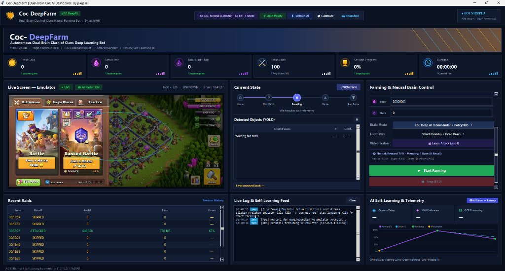
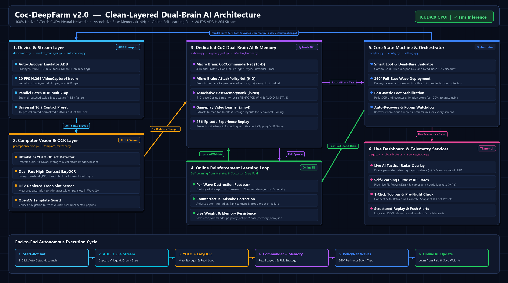
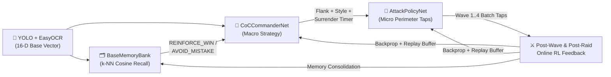

<div align="center">

# 🛡️ Coc-DeepFarm `v2.0 DeepRL`

**100% Dedicated Clash of Clans Dual-Brain Deep Learning & Online Reinforcement Learning Bot**

[](#)
[](#dual-brain-deep-learning--associative-memory)
[](#architecture)
[](#dual-brain-deep-learning--associative-memory)
[](#-1-click-quick-start-for-beginners)

<p align="center">
  <a href="#-live-dashboard-preview">Dashboard Preview</a> •
  <a href="#-architecture-overview">Architecture</a> •
  <a href="#-dual-brain-deep-learning--associative-memory">Dual-Brain AI & Memory</a> •
  <a href="#-1-click-quick-start-for-beginners">1-Click Quick Start</a> •
  <a href="#-configuration">Configuration</a> •
  <a href="#-project-structure">Project Structure</a>
</p>

</div>

---

## 🖥️ Live Dashboard Preview

<p align="center">
  
</p>

> [!TIP]
> **Zero-Focus Background Operation:** All video capture (`20 FPS H.264 stream`) and multi-touch inputs run directly over **ADB** in the background. You can minimize or cover the emulator window and use your PC normally while **Coc-DeepFarm** farms and learns autonomously.

---

## ✨ Key Highlights

| Pillar | What Makes Coc-DeepFarm Unique |
| :--- | :--- |
| 🧠 **Dual-Brain PyTorch AI (`< 1 ms` on GPU)** | Replaces slow, rate-limited external text LLMs with two purpose-built Clash of Clans neural networks: **`CoCCommanderNet`** (macro strategy) and **`AttackPolicyNet`** (micro perimeter tap trajectories). |
| 🗂️ **Associative Base Memory (`BaseMemoryBank`)** | Remembers up to **512 enemy base topologies** (`dataset/base_memory_bank.json`) via weighted **Cosine Similarity (`k-NN`)**. Automatically re-applies winning tactics (`REINFORCE_WIN`) and blocks previously failed flanks (`AVOID_MISTAKE`) on twin bases. |
| 🔄 **Autonomous Online Reinforcement Learning** | Evaluates storage destruction after every wave (`+1.0` reward for destroyed storages, `-0.5` penalty for survivors) and performs counterfactual backpropagation after every raid with a **256-episode Experience Replay Buffer**. |
| 👁️ **Live AI Tactical Radar & RL Curve** | Visualizes the AI's mind directly on the live screen—drawing the safe deployment perimeter ellipse (`min_deploy_radius`), planned tap crosshairs `(⊕)`, and real-time `PROFIT %`, `FLANK`, and `MEM %` telemetry alongside a live **Self-Learning Curve**. |
| 🎬 **Learn from Gameplay Video (`.mp4`)** | Feed recorded attack videos into `VideoAttackExtractor` via **`🎬 Learn Attack (.mp4)`** to clone your personal troop deployment order, flank preferences, and tap timing. |
| 🚀 **Beginner-Friendly 1-Click Onboarding** | Double-click **`Start-Bot.bat`**—auto-installs `.venv` & CUDA/CPU packages, opens the GUI even before the emulator starts, and ships with a **Universal 16:9 CoC 16-Button Control Preset** (`DEFAULT_CONTROLS`) so no manual button calibration is needed. |

---

## 🏗️ Architecture Overview

<p align="center">
  
</p>

The repository is structured into **six strictly separated domain layers** following **Clean Layered Architecture**:

| Layer | Package / Files | Core Responsibility |
| :--- | :--- | :--- |
| **1. Entry & Launcher** | [`Start-Bot.bat`](Start-Bot.bat), [`main.py`](main.py) | 1-click `.venv` + GPU/CPU auto-installer, non-blocking ADB startup, GUI bootstrapper |
| **2. Core Orchestrator** | [`core/bot.py`](core/bot.py), [`core/config.py`](core/config.py), [`core/settings.py`](core/settings.py) | Autonomous farming state machine, 360° multi-wave deployment, Pre-Flight readiness checks, Online RL triggers |
| **3. Neural AI & Memory** | [`ai/brain.py`](ai/brain.py), [`ai/policy_net.py`](ai/policy_net.py), [`ai/video_learner.py`](ai/video_learner.py) | `CoCCommanderNet`, `BaseMemoryBank` (`k-NN` recall), `AttackPolicyNet` (`PolicyPlanner`), and `.mp4` demonstration learner |
| **4. Computer Vision** | [`perception/vision.py`](perception/vision.py), [`perception/template_matcher.py`](perception/template_matcher.py) | Ultralytics YOLO storage detector, dual-pass high-contrast EasyOCR (`195` threshold), HSV depleted-slot detection |
| **5. Device & Stream** | [`device/adb.py`](device/adb.py), [`device/window_manager.py`](device/window_manager.py), [`device/automation.py`](device/automation.py) | Auto-discovered ADB connection, subshell-batched parallel multi-taps (~3.5× faster waves), 20 FPS FFmpeg H.264 stream |
| **6. UI & Telemetry** | [`ui/gui.py`](ui/gui.py), [`ui/calibrate.py`](ui/calibrate.py), [`services/`](services/) | Dark-mode dashboard, Live AI Tactical Radar, RL Self-Learning Curve, 1-click toolbar, `ntfy` mobile push notifications |

---

## 🧠 Dual-Brain Deep Learning & Associative Memory



### 1. Macro Strategist: `CoCCommanderNet` ([`ai/brain.py`](ai/brain.py))
Encodes the enemy base into a **16-dimensional spatial & resource vector** (`extract_base_features`) and predicts 4 tactical heads in `< 1 ms` on GPU (`models/coc_commander.pt`):
- **`profit_head`**: Expected stealable loot ratio `[0.0 .. 1.0]`.
- **`side_head`**: Optimal attack flank (`all`, `left`, `right`).
- **`style_head`**: Deployment doctrine (`0` = learned combo/tanks first, `1` = fast Sneaky Goblin collector blitz).
- **`timer_head`**: Dynamic surrender timer (`45s`–`140s`).

### 2. Associative Topological Memory: `BaseMemoryBank` ([`ai/brain.py`](ai/brain.py))
Acts as the AI's **photographic layout memory** (`dataset/base_memory_bank.json`), storing up to **512 encountered base topologies**:
- **`REINFORCE_WIN`**: When a scouted base has $\ge 92\%$ topological similarity to a past high-reward raid, the AI locks in the proven flank, style, and timer.
- **`AVOID_MISTAKE`**: When a scouted base matches a layout where a previous flank/style failed, the memory bank overrides the failed choice so the bot **never repeats the same mistake on a twin base**.
- **Memory Consolidation**: Near-identical bases ($\ge 97.5\%$ similarity) are consolidated via Exponential Moving Average (`hits + 1`) rather than duplicated.

### 3. Micro Tactician: `AttackPolicyNet` ([`ai/policy_net.py`](ai/policy_net.py))
Takes a **9-dimensional per-storage vector** (`[sx, sy, out_vx, out_vy, dist, is_gold, is_elixir, k_norm, t_norm]`) and predicts human-like perimeter offsets `(dx, dy)` and inter-tap delays `dt` (`models/policy_net.pt`), projecting every tap onto the safe outer grass ring (`min_deploy_radius`).

---

## 🚀 1-Click Quick Start (For Beginners)

### Prerequisites
- **Windows 10/11** with **Python 3.10+** (Python 3.12 recommended)
- **Android Emulator** with ADB enabled (**MuMu Player 12**, **LDPlayer**, **BlueStacks**, or **MEmu**)
- *(Optional)* **NVIDIA GPU** (RTX 20/30/40 series) for CUDA acceleration & **`ffmpeg`** on `PATH` for 20 FPS H.264 streaming

### Step-by-Step (Zero Terminal Commands Needed!)

1. **Double-click [`Start-Bot.bat`](Start-Bot.bat)**:
   - On your first run, [`Start-Bot.bat`](Start-Bot.bat) automatically creates `.venv`, detects your NVIDIA GPU (`nvidia-smi`), installs the matching CUDA or CPU packages, and opens the dashboard.
2. **Open Clash of Clans in Your Emulator**:
   - Even if you opened the bot *before* starting your emulator, the dashboard opens normally.
3. **Click `▶ Start Farming`**:
   - The bot automatically runs its **Pre-Flight Check**: connects to your emulator via ADB, starts the live video feed, and applies the built-in **Universal 16:9 CoC 16-Button Preset** (`DEFAULT_CONTROLS`).

> [!NOTE]
> **Want to train the AI on your own attack video?** Click **`🎬 Learn Attack (.mp4)`** in the dashboard control panel and select any recorded Clash of Clans attack video (`.mp4`). Both `CoCCommanderNet` and `AttackPolicyNet` will immediately train on your gameplay!

---

## ⚙️ Configuration

Runtime settings are stored in [`settings.json`](settings.json) (automatically seeded from [`settings.example.json`](settings.example.json) with full 16:9 button coordinates on first launch):

| Section | Key Options | Description |
| :--- | :--- | :--- |
| **`controls`** | `attack_btn_home`, `find_btn`, `nxt_btn`, `s_goblin`, `troop_slot_1..5`, `surr`, `surr_conf`, `return_home`, `retry_btn_1..3` | Pre-calibrated normalized `(x, y)` coordinates (`0.0–1.0`). Customize anytime via **`🎯 Calibrate`** |
| **`attack`** | `target_mode` (`"smart"` \| `"and"` \| `"or"`), `drain_ratio`, `time_limit` | Loot filter mode (`smart` enables Combo Gold+Elixir, 1.6× Jackpot, & 15% Dead-Base discount) |
| **`troops`** | `slots`, `deploy_mode` (`"target"` \| `"tap"` \| `"hold"`), `skip_empty_slots` | Troop bar slots, `PolicyNet` perimeter target deployment, and HSV grayscale empty-slot skipping |
| **`brain`** | `name` (`"coc_ai"` \| `"rule"`), `use_ai` (`true` \| `false`) | Switches between `CoCCommanderNet` + `BaseMemoryBank` (`coc_ai`) and `RuleBrain` (`rule`) |

---

## 📂 Project Structure

```text
Coc-DeepFarm/
├── Start-Bot.bat              # 🖱️ 1-Click Beginner Auto-Installer & Launcher
├── main.py                    # Application entry point, non-blocking ADB init & --selftest
├── core/                      # Domain & application orchestration layer
│   ├── bot.py                 # CocBot farming loop, 360° waves, Online RL & Pre-Flight triggers
│   ├── config.py              # AppConfig dataclass (paths, thresholds, ADB defaults)
│   ├── settings.py            # Universal 16:9 DEFAULT_CONTROLS & settings.json persistence
│   └── utils.py               # Runtime environment & path helpers
├── ai/                        # Dedicated CoC Deep Learning, Memory & Online RL layer
│   ├── brain.py               # CoCCommanderNet, BaseMemoryBank (k-NN) & CoCTacticalBrain
│   ├── policy_net.py          # AttackPolicyNet & PolicyPlanner (perimeter taps + Online RL)
│   └── video_learner.py       # VideoAttackExtractor (.mp4 gameplay -> neural dataset)
├── perception/                # Computer vision & OCR layer
│   ├── vision.py              # Ultralytics YOLO detector + dual-pass high-contrast EasyOCR
│   └── template_matcher.py    # Multi-scale OpenCV button verification
├── device/                    # Emulator & OS transport layer
│   ├── adb.py                 # ADB client, subshell batch multi-tap, H.264 stream reader
│   ├── window_manager.py      # Resolution discovery, live frame capture & screenshot fallback
│   └── automation.py          # High-level click, batch tap & press-and-hold dispatch
├── services/                  # Telemetry & external notification services
│   ├── logger.py              # Console + rotating file logging (logs/bot.log)
│   ├── notify.py              # Optional ntfy.sh mobile push notifications
│   └── replay.py              # Per-raid JSON telemetry recorder
├── ui/                        # Desktop presentation layer
│   ├── gui.py                 # Dark-mode dashboard, AI Tactical Radar, RL Curve & quick toolbar
│   └── calibrate.py           # Interactive button calibrator with 1-Click Reset Preset
├── models/                    # Neural network weights (best.pt, coc_commander.pt, policy_net.pt)
├── dataset/                   # Self-learned RL history, BaseMemoryBank JSON & video demos
├── templates/                 # Reference button crops for visual click verification
├── tests/                     # Automated unit & integration test suite (unittest)
└── docs/                      # Detailed documentation & architecture diagrams
```

---

## 📚 Documentation Index

- 🏛️ **[Architecture Guide](docs/ARCHITECTURE.md)** — Deep dive into the 6-layer architecture, Dual-Brain neural networks, `BaseMemoryBank`, and data flow.
- 🚀 **[Usage & Dashboard Guide](docs/USAGE.md)** — Complete walkthrough of dashboard controls, AI Tactical Radar, and 1-click workflow.
- ⚙️ **[Configuration Reference](docs/CONFIGURATION.md)** — Detailed breakdown of `AppConfig` and `settings.json` keys.
- 🧪 **[Development & CLI Training](docs/DEVELOPMENT.md)** — Running unit tests, `--selftest`, and CLI model training.
- 🛠️ **[Troubleshooting](docs/TROUBLESHOOTING.md)** — Solutions for common emulator, ADB, and OCR questions.
