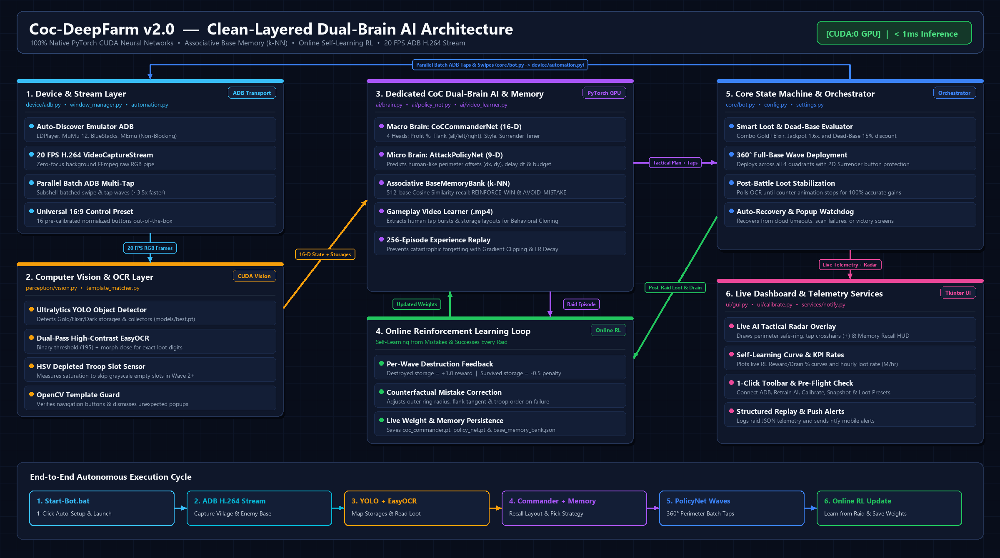
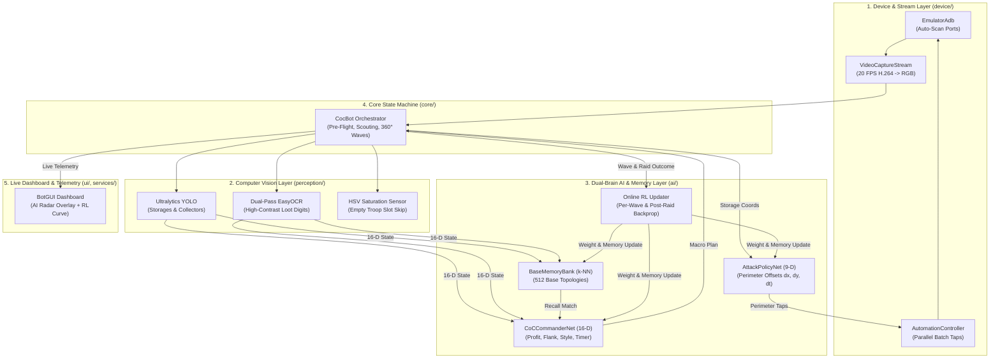

# 🏗️ System Architecture (`Coc-DeepFarm v2.0`)

  

---

## 1. Architectural Philosophy

**Coc-DeepFarm** follows **Clean Layered Architecture** combined with a **Dual-Brain PyTorch Deep Learning + Associative Memory** core:
- **Zero Desktop Intrusion:** All video frames (`20 FPS H.264 stream` via `screenrecord` + FFmpeg) and touch events (`adb shell input`) travel directly over **ADB**, so your mouse cursor and active window focus are never hijacked.
- **Zero External API / LLM Latency:** Instead of calling slow, rate-limited general-purpose text LLMs, **Coc-DeepFarm** runs two domain-specialized PyTorch neural networks (`CoCCommanderNet` and `AttackPolicyNet`) plus a topological vector memory (`BaseMemoryBank`) natively on your GPU (`CUDA:0`) in **`< 1 ms`**.

---

## 2. End-to-End Runtime Data Flow

---

## 3. Clean Layered Package Breakdown

| Layer | Module | Key Classes / Functions | Responsibility |
| :--- | :--- | :--- | :--- |
| **Launcher** | [`Start-Bot.bat`](../Start-Bot.bat), [`main.py`](../main.py) | `_ensure_venv()`, `main()`, `_selftest()` | 1-Click `.venv` setup, CUDA detection, non-blocking ADB startup |
| **Core** | [`core/bot.py`](../core/bot.py) | `CocBot` | Main farming state machine, Pre-Flight checks, 360° wave loop, Online RL triggers |
| **Core** | [`core/settings.py`](../core/settings.py) | `DEFAULT_CONTROLS`, `ensure_default_controls()` | Universal 16:9 16-button preset and `settings.json` persistence |
| **AI & Memory** | [`ai/brain.py`](../ai/brain.py) | `CoCCommanderNet`, `BaseMemoryBank`, `CoCTacticalBrain` | 16-D strategic neural network, k-NN topological memory recall, macro Online RL |
| **AI & Memory** | [`ai/policy_net.py`](../ai/policy_net.py) | `AttackPolicyNet`, `PolicyPlanner` | 9-D micro perimeter tap generator, 256-sample Experience Replay, counterfactual RL |
| **AI & Memory** | [`ai/video_learner.py`](../ai/video_learner.py) | `VideoAttackExtractor` | Extracts human tap bursts & storage layouts from `.mp4` videos |
| **Perception** | [`perception/vision.py`](../perception/vision.py) | `VisionManager` | YOLO object detection + dual-pass binary threshold (`195`) EasyOCR |
| **Perception** | [`perception/template_matcher.py`](../perception/template_matcher.py) | `find_template()`, `verify_screen_change()` | Multi-scale OpenCV button verification & popup dismissal |
| **Device** | [`device/adb.py`](../device/adb.py) | `EmulatorAdb`, `VideoCaptureStream` | Multi-emulator ADB auto-discovery, subshell batch tapping, FFmpeg H.264 stream |
| **UI** | [`ui/gui.py`](../ui/gui.py), [`ui/calibrate.py`](../ui/calibrate.py) | `BotGUI`, `Calibrator` | Dark-mode dashboard, Live AI Tactical Radar, RL Self-Learning Curve, 1-Click Reset Preset |

---

## 4. Three-Tier Neural Memory System

**Coc-DeepFarm** combines three complementary forms of memory:

1. **Short-Term Working Memory (`_current_episode` in [`ai/policy_net.py`](../ai/policy_net.py))**:
   - Tracks every storage coordinate, predicted offset, and depleted troop slot (`_empty_slots`) across Waves 1–4 of the active battle.
2. **Associative Topological Base Memory (`BaseMemoryBank` in [`ai/brain.py`](../ai/brain.py))**:
   - Stores up to **512 encountered base layouts** in [`dataset/base_memory_bank.json`](../dataset/base_memory_bank.json).
   - Uses weighted **Cosine Similarity** over spatial geometry (`dead_base`, `avg_dist`, quadrant densities, outer-ring exposure, and spread) to immediately recognize twin bases ($\ge 92\%$ match) and trigger either **`REINFORCE_WIN`** or **`AVOID_MISTAKE`**.
3. **Long-Term Synaptic & Replay Memory ([`models/coc_commander.pt`](../models/coc_commander.pt), [`models/policy_net.pt`](../models/policy_net.pt))**:
   - Backed by a **256-sample Experience Replay Buffer**, gradient norm clipping (`max_norm=0.5`), and adaptive learning-rate decay so the neural networks continuously improve without catastrophic forgetting.
