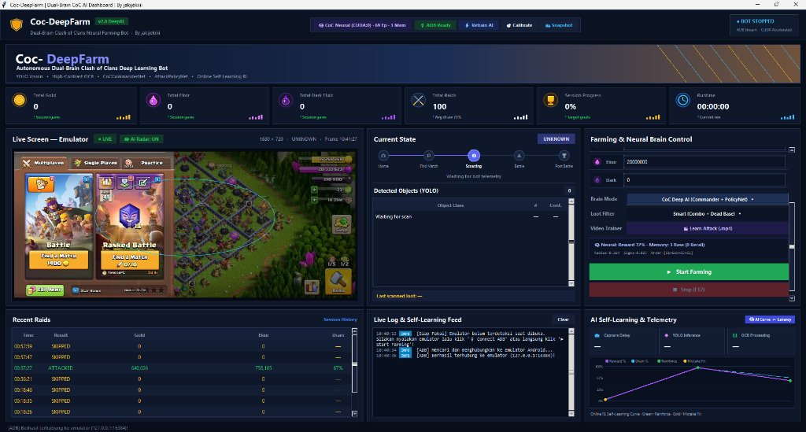

# 🚀 Usage & Dashboard Guide

  

---

## 1. 🖱️ 1-Click Quick Start (Beginner Workflow)

> [!TIP]
> You do **not** need to open a terminal or manually calibrate 16 buttons on standard landscape emulators (`1280x720`, `1600x900`, `1920x1080`, `1680x720`).

1. **Double-click [`Start-Bot.bat`](../Start-Bot.bat)**:
   - Automatically creates `.venv` and installs GPU (CUDA) or CPU dependencies on first run, then opens the dashboard.
2. **Start Your Emulator & Open Clash of Clans**:
   - Even if you launched the bot before starting your emulator, the dashboard stays open.
3. **Click `▶ Start Farming`**:
   - Runs an automatic **Pre-Flight Check**:
     - Auto-connects to your emulator over ADB and starts the 20 FPS live video stream.
     - Automatically loads the **Universal 16:9 CoC 16-Button Control Preset** (`DEFAULT_CONTROLS`).

---

## 2. 🎛️ Interactive Dashboard Controls

### Top Quick-Action Toolbar
| Button / Badge | Function |
| :--- | :--- |
| **`🧠 CoC Neural (CUDA:0) · N Ep · M Mem`** | Displays active compute device, total learned episodes, and stored layouts in `BaseMemoryBank` |
| **`🔌 ADB Ready` / `🔌 Connect ADB`** | One-click ADB connection & live stream starter if you opened the emulator after the bot |
| **`⚡ Retrain AI`** | Retrains `CoCCommanderNet` + `AttackPolicyNet` in the background from all videos and raid logs |
| **`🎯 Calibrate`** | Opens [`ui/calibrate.py`](../ui/calibrate.py) (includes a **Reset Preset** button to restore 16:9 defaults) |
| **`📸 Snapshot`** | Saves the current emulator frame to `logs/snapshot_<timestamp>.png` |

### Live Screen & AI Tactical Radar (`👁 AI Radar: ON`)
- **Cyan Perimeter Ring**: Visualizes the AI's learned safe deployment radius (`min_deploy_radius`) around the enemy village.
- **Green Target Crosshairs `(⊕)`**: Marks exact troop deployment coordinates during battle waves.
- **Top-Left Tactical HUD**: Shows real-time `PROFIT %`, `FLANK` (`ALL`/`LEFT`/`RIGHT`), and `MEM` recall status (`WIN`, `FIX`, or `NEW`).

### Farming & Neural Brain Control Panel
- **Quick Loot Presets (`400k`, `700k`, `1M+`)**: Instantly sets Gold & Elixir minimum raid targets with 1 click.
- **Brain Mode**: Toggle between **`CoC Deep AI (Commander + PolicyNet)`** and **`Rule-based + PolicyNet`**.
- **Loot Filter**: Cycle between **`Smart (Combo + Dead Base)`**, **`Strict (AND)`**, and **`Flexible (OR)`**.
- **`🎬 Learn Attack (.mp4)`**: Select a gameplay video to extract your human tap trajectory and train both neural networks.

### Dual-Mode Bottom-Right Telemetry Chart (`🧠 AI Curve ⇄ Latency`)
- **AI Self-Learning Curve Mode**: Plots **Reward %** (purple), **Loot Drain %** (cyan), **Reinforce Success** dots (green), and **Mistake Fix** dots (gold) across your raids.
- **System Latency Mode**: Plots real-time frame capture, YOLO detection, and OCR latency in milliseconds (`ms`).
